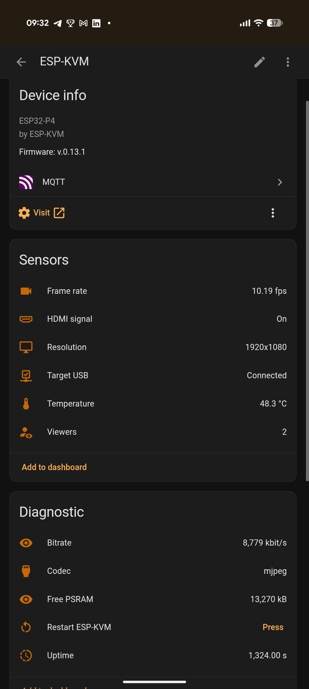

ESP-KVM talks to Home Assistant over MQTT. There is no add-on and no custom integration to install: it sends MQTT discovery messages, and Home Assistant makes one device out of them with everything listed below. MQTT is off by default and costs nothing while off.

## Setting it up

1. Have an MQTT broker. On a stock Home Assistant that is the Mosquitto broker add-on, with the MQTT integration added.
2. In the ESP-KVM console open Settings, MQTT / Home Assistant, and turn on Publish to MQTT.
3. Enter the broker host (the Home Assistant host, for the add-on) and the port: 1883, or 8883 with Use TLS on. Add a username and password if the broker wants them.
4. Save. The device appears in Home Assistant under Settings, Devices & services, MQTT.

The base topic is `espkvm/<device id>`, and the discovery prefix is `homeassistant`, which suits a stock install. Both can be changed, along with how often telemetry goes out.

## What shows up

The target machine:

- HDMI signal, resolution, frame rate, codec and bitrate.
- Whether the USB link to the target works, and whether the target's USB port has power.
- Target power, and Power, Reset and Force off buttons, with the ATX wiring on a board that has the pins for it.
- The HDMI source and its power state, and buttons to wake it or put it to sleep, when HDMI-CEC is on.
- A Wake on LAN button, once the target's MAC address is set.

The screen:

- A camera, Target screen, holding a still of the screen, and a button to take a new one. A screen alert can take one by itself.
- Screen alert, on when watched words appear on the screen, with the text it found.
- Screen one colour, and for how long: a stop screen, a blank output, a desktop that died.
- A sensor for each screen area you set up, and its colour if it watches one.

Doing things:

- One button per runbook, and a sensor with the runbook's progress.
- Recording to the microSD card as a switch, and buttons for a screenshot, a dashcam clip and a timelapse.
- The mouse jiggler as a switch, with its interval.
- Restart ESP-KVM.
- Firmware updates as an update entity with an Install button, when Let the device fetch releases itself is on.

Diagnostics: chip temperature, viewers, uptime, free memory, the firmware version and slot, and why it last booted.

## Ideas

- Wake the machine at 7 and press its power button if it did not come up.
- A notification with the screen's picture when a server shows a kernel panic.
- Turn the jiggler on at night only.
- Run a runbook that walks a BIOS menu from a dashboard button.

## Good to know

- Entities that need hardware a board does not have, such as the ATX pins, do not appear.
- A still of a 1080p screen is a few hundred kilobytes over the broker, so it is sent only when asked for or when an alert fires with the picture setting on.
- The password for the broker stays on the device and is never sent back to the console.
