The device now has a second password, for someone who should see the screen and not touch it. The rest of the release is a pile of small console changes I had wanted for a while.

## A view-only sign-in

Settings, Security has a password for the user `viewer`. Whoever signs in with it gets the picture, the sound and the recordings. They cannot type, click, press the power button or change a setting. The device itself refuses these requests. The console only hides the buttons. Setting a new viewer password, or removing it, signs out everyone who was watching.

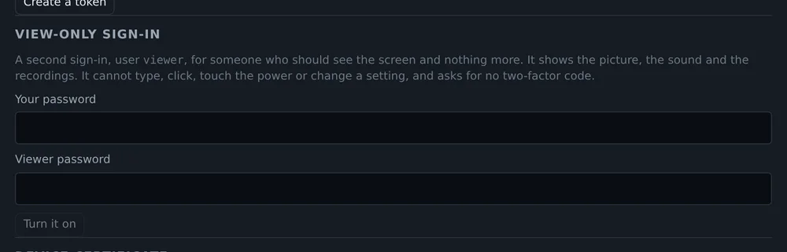

The status bar shows an eye with the number of other open consoles. A click lists their addresses and who is in control.

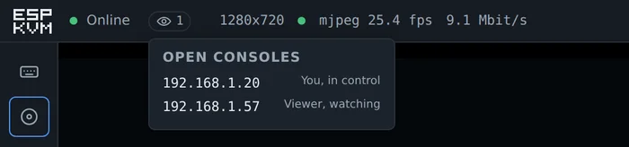

## Keyboard shortcuts

While the keyboard is not captured by the target, single keys open things: F for full screen, I for Input, M for virtual media, A for automation, R for recordings. ? shows the list, along with how to get Esc, Ctrl+Alt+Del and the Windows key to the target when your own computer grabs them first.

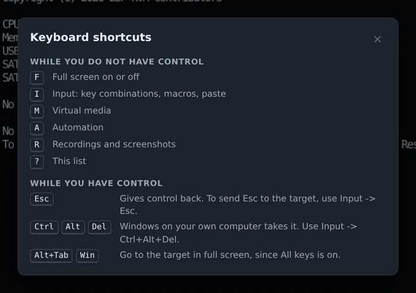

## Paste

Some browsers will not let a page read the clipboard, for example over plain HTTP. Under Paste text there is now a box to type or paste the text into, and a button that sends it.

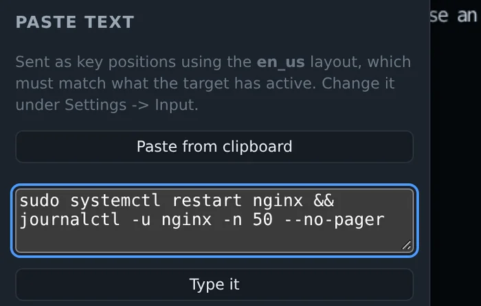

A long text takes a while at keyboard speed. Now there is a progress bar and a Stop button, in case it was the wrong text.

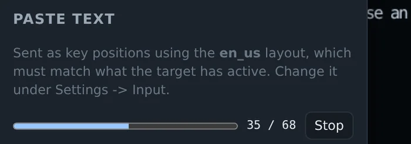

## Is the picture alive

A still screen and a dead stream look exactly the same. So the green dot next to "Online" now does more than say the device answers. It pulses while frames arrive. It stays still when the target's screen is not changing and the device sends almost nothing. It turns amber when the device says it sends frames, but none reached the tab for 4 seconds.

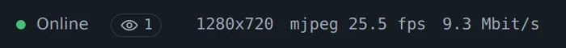

## The keys sent

You press F2, the BIOS does not open. Did the key even leave the browser? Settings, UI, "Show the keys sent" puts the last six keys in the bottom bar. If F2 is there, the device sent it. If not, your laptop probably ate it. Keys from the on-screen keyboard, macros and paste show up too.

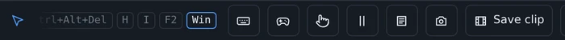

## The HDD LED

The power LED could be wired before. The disk LED goes the same way now, to the pin in `atx_hdd_gpio`. Next to the power button on the left a yellow dot blinks while the disk works. On a black screen, a blinking disk usually means the machine is still booting.

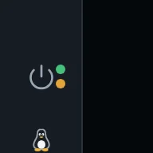

## Pointer and scrolling

Your own cursor over the picture can now be a small dot, or hidden, so two arrows do not sit on top of each other.

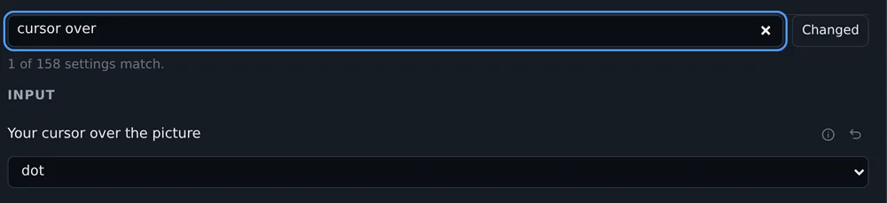

Some targets draw a 4:3 desktop in a 16:9 mode, with black bars on the sides. Clicks there landed off the pointer, more so near the edges. "Find this screen" now handles that too, and draws where the desktop sits.

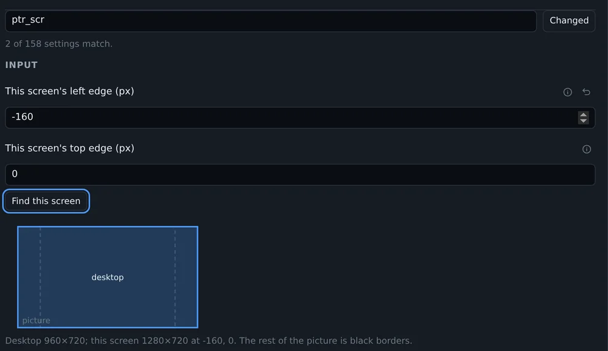

Scrolling with a touchpad often did nothing, and so did a mouse wheel in Firefox. Firefox reports a notch as about 48 pixels, a touchpad sends a few pixels at a time. The console divided by 100 and rounded, which gave zero. Now small steps add up, and every notch is at least one click on the target. Scroll speed is a setting too.

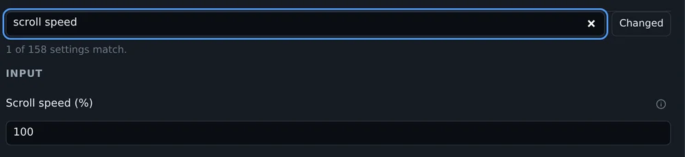

## Colors in MJPEG

On rev 3.x boards MJPEG looked washed out. Black came out dark grey and white a little dim. The HDMI bridge sent black as 16 and white as 235, and a browser reads a JPEG as 0 to 255. I saw it with the console open on the target itself: every picture inside a picture was lighter than the one around it. The bridge now sends the full range, and H.264 says in its stream which range it uses.

## Smaller things

- On a phone, a long press on a button in a bar shows its name. A phone has no hover.
- A new page lists what the device can do: each feature, whether it is on, and a button to its settings. Settings, System opens it.

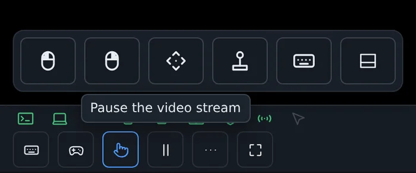

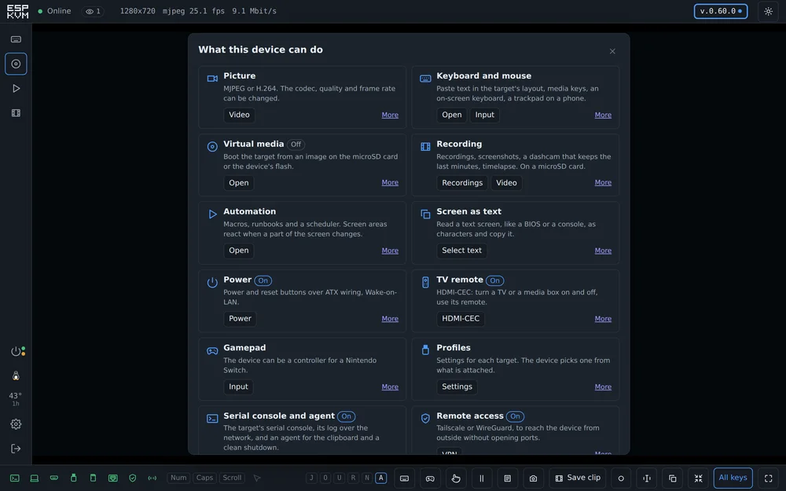

[Release 0.76.0 on GitHub](https://github.com/espkvm/espkvm/releases/tag/v.0.76.0)
