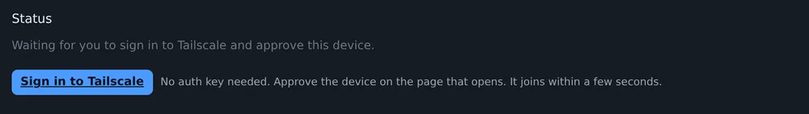
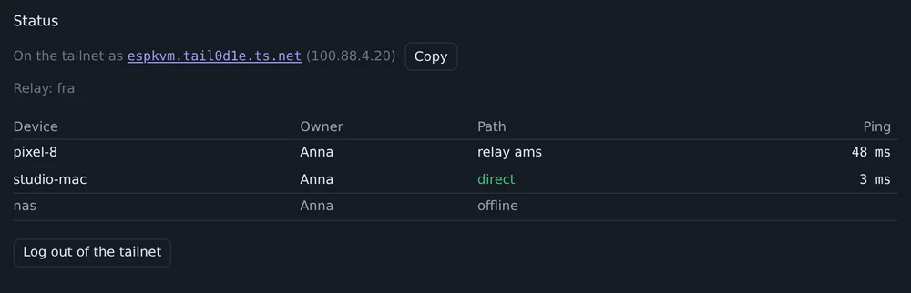
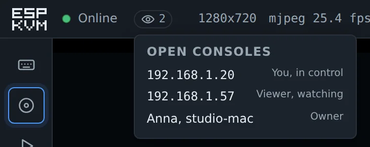
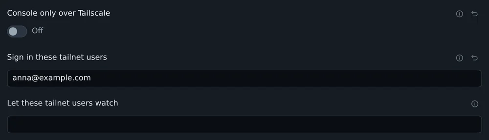
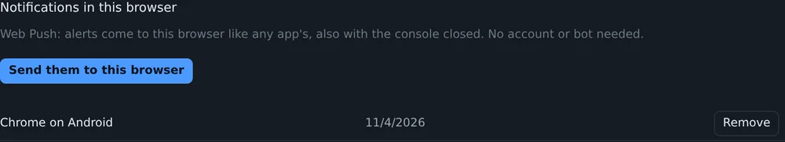

Most of this release is Tailscale. Since Malta the device at home lives on it, and I kept running into small things. The rest is two browser features I had wanted for a while: alerts without Telegram, and the screen in a small window.

## Sign in instead of an auth key

Before, the device needed an auth key. You had to open the Tailscale admin console, make a key, copy it, paste it into the device. Now the key field can stay empty. The VPN tab shows a Sign in to Tailscale button. It opens Tailscale's own page, you approve the device there, and a few seconds later it is on the tailnet.

Log out of the tailnet does the opposite. The device forgets its keys, and the next start asks for a sign-in again. For Tailscale it is then a new machine. Mine came back as espkvm-3, because the old espkvm was still in the admin console and kept the name. Delete the old one there and rename the new one.

## Who is on the tailnet

The VPN tab used to say only on or off. Now it shows the device's name, as a link with a Copy button, its 100.x address, the relay it uses, and every peer: whose it is, direct or through which relay, and the last round trip. When the console is slow from a phone, look here first. Mine was going through the relay in Amsterdam, 48 ms instead of 3 ms direct.

The list of open consoles under the eye icon now shows a tailnet device by name and owner, not as 100.101.7.12.

## Let the tailnet in

Three new settings in the VPN tab:

- Console only over Tailscale. While the tailnet is up, the console answers only to 100.x addresses. The setup hotspot still works. If Tailscale goes down, the LAN works again, so a broken tailnet does not lock you out.
- Sign in these tailnet users. A list of Tailscale logins. A browser on one of their devices opens the console with no password. Tailscale already checked who it is.
- Let these tailnet users watch. The same, but as the view-only user from 0.76.0.

Both lists work only after you set a password of your own.

## Updates that were thrown away

The control server tells the device when something about a peer changes. A big change, like a restart, comes as the whole peer. A small one comes as a short patch: the peer went offline or came back, it has a new address, a new relay. The client I use, microlink, expected these patches as an object keyed by node key. Tailscale sends a list keyed by node ID. So every patch was thrown away, and nothing in the log said so.

You could see it in the console. A laptop that went offline stayed online for the device, with its old address, until the next full update. Now the patches are read. I turned Tailscale off on my laptop and on again: the device marked it offline in 4 seconds, online when it came back, and went direct 13 seconds later.

## Headscale

A self-hosted control server never worked at all. The device always expected the server key of Tailscale's own server, and Headscale has its own. Now the device asks the server for its key. It also reads the netmap from the stream, where Headscale 0.26 and newer send it. The Control server field takes a full URL too, like `https://hs.example.com:8443`.

## Alerts in the browser

Until now an alert could go to Telegram or to a webhook, and both take some setting up. Settings, Notifications now has a third way: Send them to this browser. The browser asks for permission, and from then on alerts show up like any app's, also with the console closed.

It is Web Push, the same thing news sites use to bother you. The browser subscribes with its push service: Google's for Chrome and Edge, Mozilla's for Firefox, Apple's for Safari. The device gets the address and two keys. For each alert it encrypts the text for that one browser, signs the request with a key it made for itself, and posts it to that address. No account and nothing to register. The device needs a way out to the internet, the same as for Telegram.

The console has to be on HTTPS with a certificate the browser trusts, for example the Let's Encrypt one over Tailscale. On an iPhone it also has to be added to the Home Screen first. Up to 8 browsers, each with a Remove button.

## The screen on top

A button next to Full screen, or P, puts the target's screen in a small window that stays above other windows. Only the picture goes there, no input. A console in a background tab normally stops decoding the stream, but not while the small window is open. Chrome and Edge on a desktop have it. Other browsers do not show the button.

## Three consoles, no restarts

With three or four consoles open, the device could restart every couple of minutes. Internal RAM ran out, and with it went the link to the Wi-Fi chip. Two things took it. WebRTC encrypted every video packet with the AES engine, and the engine's DMA took a buffer from internal RAM each time. And every viewer's sender kept its stack there. Now a packet goes to the engine in pieces small enough that it does them without DMA, and the stacks are in PSRAM.

## Fixes from a fork

[Csontikka/microlink](https://github.com/Csontikka/microlink) is a fork of the same client, used for Tailscale in ESPHome. It is about 70 commits ahead of the original. None of them applied cleanly to my branch, so I moved the generic fixes over by hand. Thanks, Csontikka. What changed:

- A Tailscale restart leaked the relay connection and the WireGuard state, and could free the client while one of its tasks still ran.
- Two packets sent at the same moment could get the same WireGuard counter.
- A large netmap that came in several reads could be lost or read from the middle.
- The relay gave up after three failed connects and stayed down. Now it keeps trying, and a relay that went silent is reconnected after 90 seconds.
- The relay's TLS certificate is now checked. Before, someone on the path could see who talks to whom. The WireGuard traffic itself was always encrypted.
- A peer reachable at two addresses no longer flips between them.
- The device notices at once when the control server closes the connection. It used to take up to two minutes.
- Tailscale follows the device to a new address when Ethernet and Wi-Fi swap or the DHCP lease changes.
- A Tailscale probe costs one key derivation per peer, not one per packet.

## Smaller things

- Settings, Network, "Say on the network that this is an ESP-KVM" adds the product and the board to the mDNS announcement, and an `_espkvm._tcp` service. A script can then find every ESP-KVM on the network. It is off by default, and the firmware version is never announced.
- On/off settings are toggles now. Next to a tick box, "Off" read like what a click would do.
- The VPN tab left out four Tailscale settings, among them the trusted certificate. Only search found them.
- On a phone the row of settings sections did not scroll sideways. Notifications and Security were past the edge and could not be opened.
- A setting switched while the device could not save it, during a restart for example, stayed switched on screen next to the old "Off".
- With the network down, every new alert made the device try the whole backlog again at once. A screen area that changes every second meant a send attempt every second.
- A machine renamed in the Tailscale admin console kept its old name on the device until it reconnected.
- The Tailscale admin console could not show the device's certificate: "Could not retrieve status from machine". Now it shows how long it is valid.

[Release 0.77.0 on GitHub](https://github.com/espkvm/espkvm/releases/tag/v.0.77.0)
