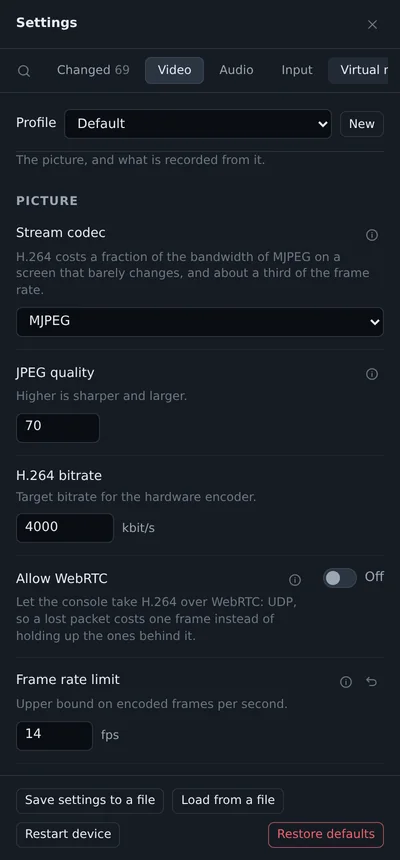
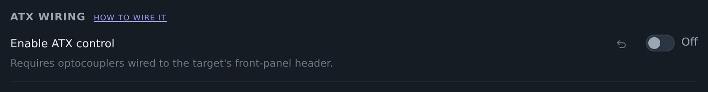
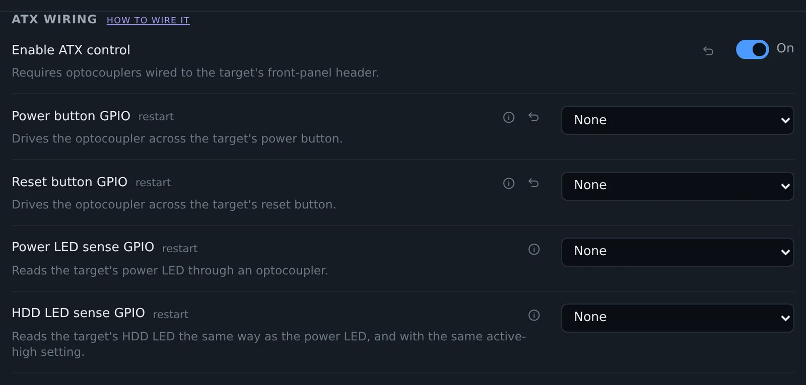
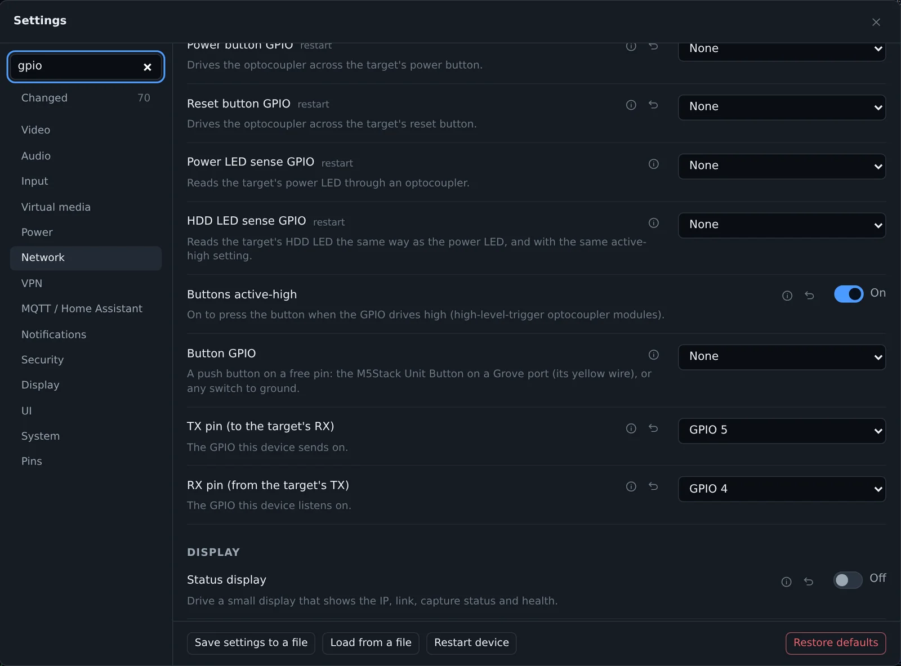
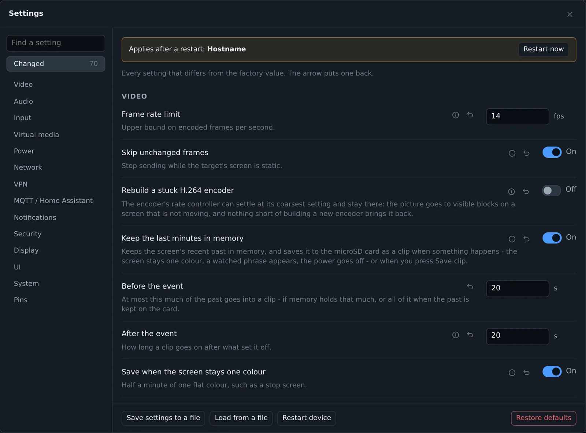

The settings page had grown to 167 settings, and it looked like it. This release changes how they are shown, nothing else. Your saved settings stay as they were.

## One line per setting

On a wide window the control now sits to the right of the name, and the first sentence of the help goes under it. The rest of the help opens on (i). On a phone they stay one under the other, except toggles.

## Fields that do not apply are hidden

A setting that only matters while another one is on stays hidden until it is. The static address hides while DHCP is on, the ATX pins while ATX is off. The same goes for the MQTT, dashcam, notification, netconsole and serial fields.

The device follows the same rule when it checks the pins. A pin that belongs to a switched-off feature does not block another one. When the feature is switched back on, its pins are checked again, so two things still cannot end up on one GPIO.

A group the board cannot have at all, such as Wi-Fi on a board without it, says so in one line and folds up.

## Words and units

Choices read as words: MJPEG and H.264, English (US), Detect, Keep trying. Numbers have their unit next to the box, so you no longer guess whether 200 is ms or s.

## One restart bar

Some settings only apply after a restart. Before, the console asked you after each one. Now they collect in one bar at the top, with a Restart now button, and you restart once.

## Finding a setting

The search box is at the top of the section list, and `/` or Ctrl+F jumps to it. On a phone it is a button at the start of the tabs. It looks through the names, the help and the API keys.

Changed is a section of its own now, with a count. It lists every setting that differs from the factory value, from all sections. The arrow next to one puts it back.

## Smaller things

- Network starts with the address. Netconsole moved to the end.
- The EDID profile and Watch the screen have their own groups under Video.
- The profile picker shows only in sections that have settings a profile can hold.
- Password, two-factor, view-only sign-in, viewing token and the certificate under Security fold to one line each.
- The schema (`GET /api/v1/settings/schema`) has `labels`, `unit` and `showIf.ne`, for anyone who builds their own settings page.

[Release 0.78.0 on GitHub](https://github.com/espkvm/espkvm/releases/tag/v.0.78.0)
