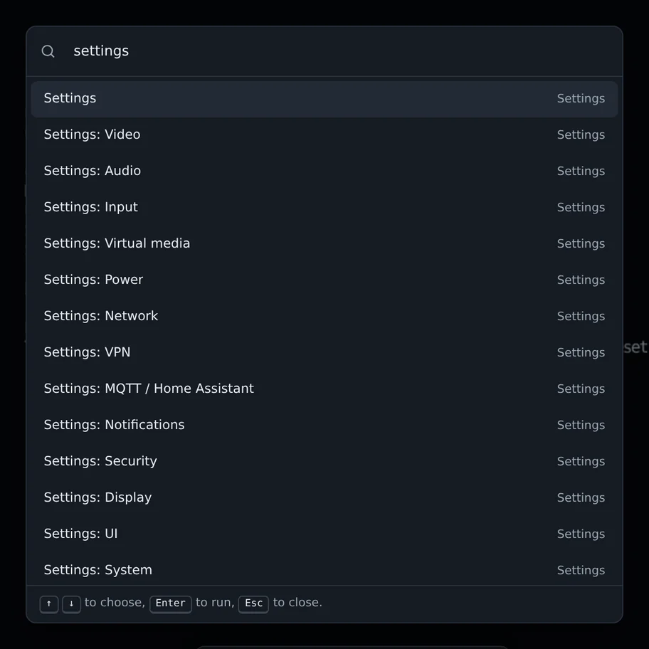
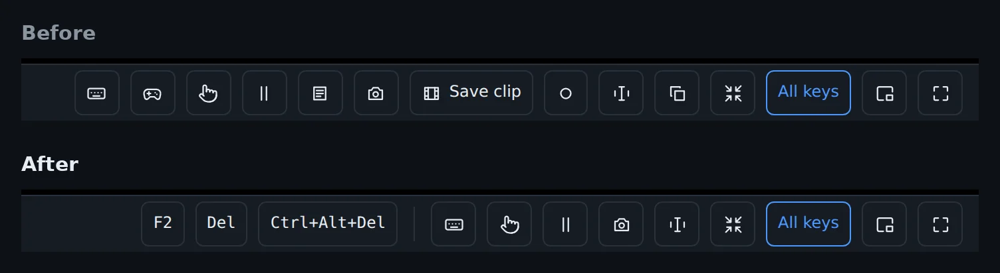
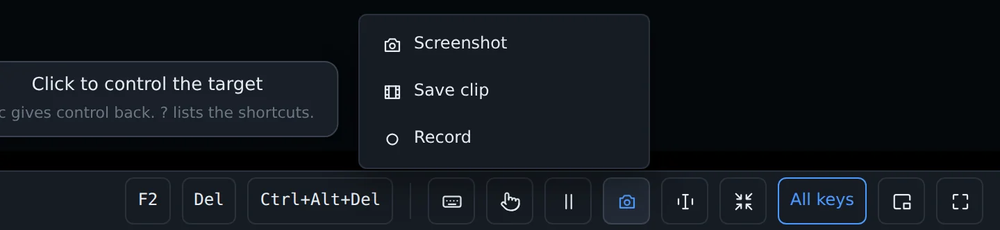
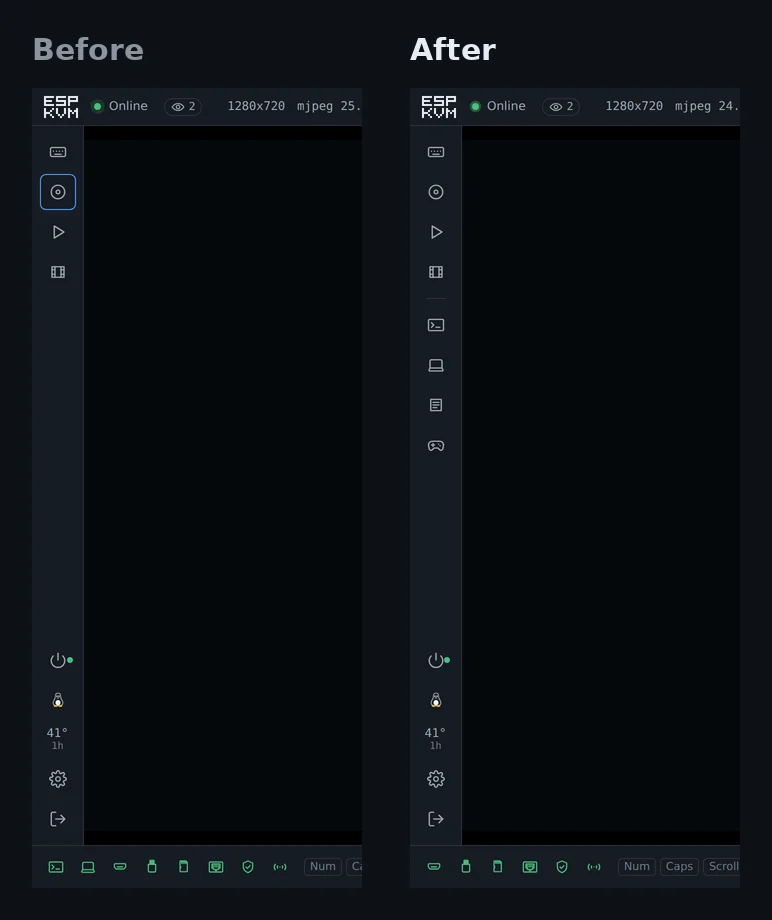
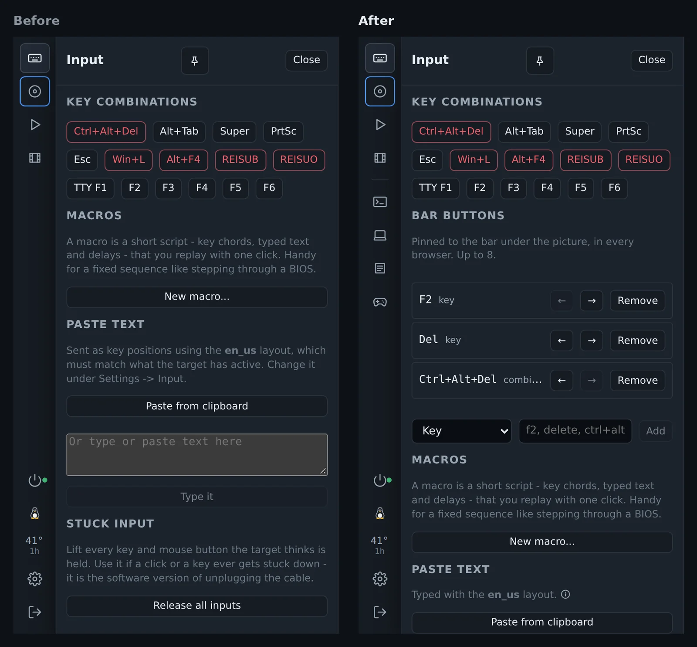
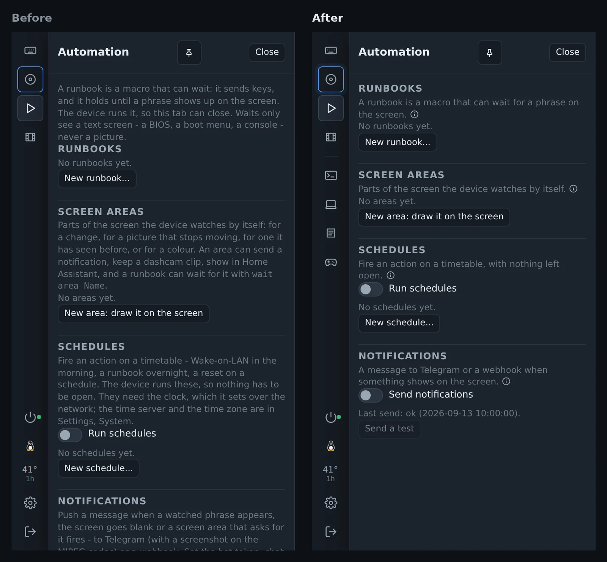
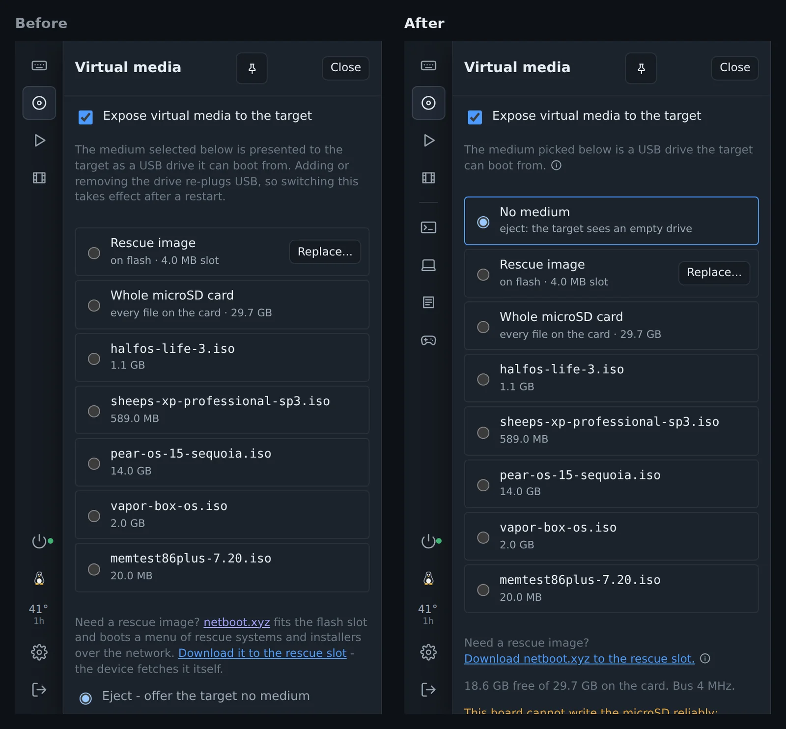
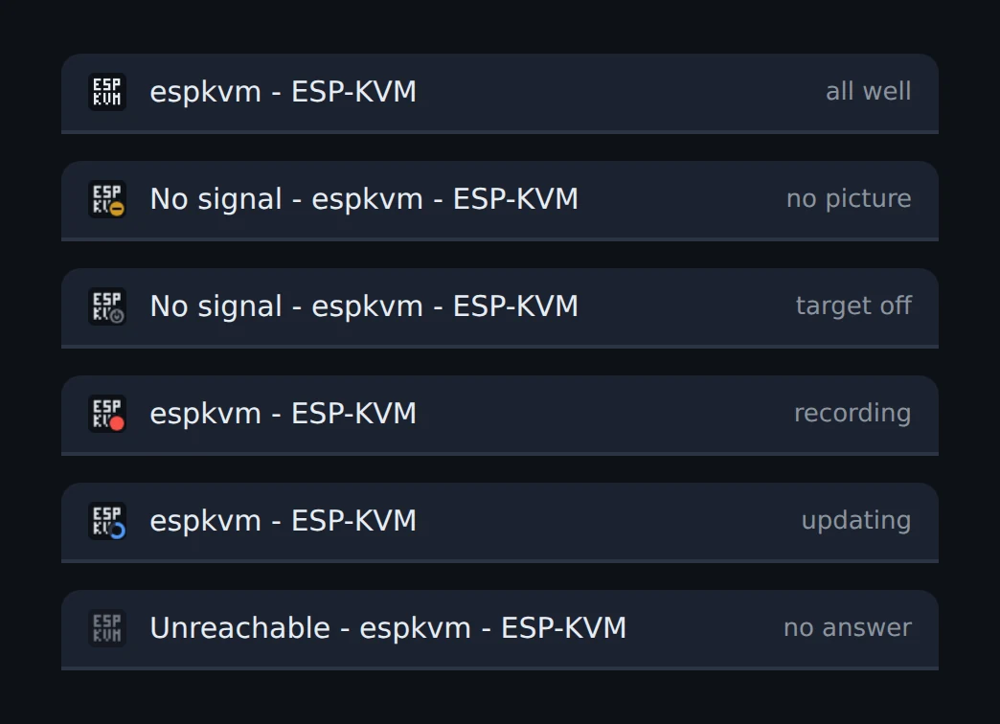

The console had picked up a button for each new feature, and the bar under the picture got long. In 0.79.0 you can type what you want instead of looking for its button, and I moved the buttons around. Nothing was removed, and your settings stay as they were.

## Ctrl+K

Press [[Ctrl+K]] or [[Ctrl+Shift+P]] ([[Cmd]] on a Mac) and type what you want. [[Enter]] runs it. There is also a search button at the top right, and on a phone a Commands item in the More menu.

The list has the panels and windows, Capture and Screen text, every key combination from Input for the target's OS, your macros and runbooks, the ATX power button, the view options and each Settings section by name. Type part of a setting's name, such as "hostname" or "codec", and Enter opens Settings on that field. It shows only what this device and this sign-in can do. The power button asks first.

A typed word has to match the start of a word, so "scr" finds Screenshot and "the screen" but not "description". With nothing typed, the last five commands you ran come first.

While the console has control of the target, keys go to the target, so press [[Esc]] first. In the serial console [[Ctrl+K]] stays with the terminal, where it deletes to the end of the line. [[Ctrl+Shift+P]] works there.

## The bar under the picture

Screenshot, Save clip and Record are one Capture button now. Select text and Copy as text are one Screen text button. The gamepad and the target log moved to the rail. That makes five buttons fewer. F2, Del and Ctrl+Alt+Del on the new bar are my own bar buttons, see below.

Capture and Screen text open a short list with names instead of bare icons. While a recording runs, its clock shows on the Capture button.

## Windows in the rail

The serial console, the agent, the target log, the TV remote and the gamepad open from the left rail, under the panels. A button shows only when its window can work: Serial once its pins are set, Agent once the program runs on the target. The green icons in the bottom left corner only show status.

On a phone the rail is hidden, so these are in the More menu.

## Your own buttons

Input has a new Bar buttons section. Add a key (`f2`, `delete`, `ctrl+alt+f2`), a built-in combination, one of your macros or a runbook, and it gets a button on the bar. Up to 8, in the order you set with the arrows. A key name the console does not know is refused right away.

The list is kept on the device (`quick_json`), so every browser that opens the console shows the same buttons.

## Shorter panel help

Each panel used to open with a paragraph of explanation. Now only the first sentence shows, and the rest opens on (i), as in Settings. Automation fits on one screen.

## Virtual media

No medium is the first row of the list. Pick it to eject. Before, eject was a separate line under the list. While an image is in, the disc button in the rail has a dot.

## The tab icon

The console's icon in the browser tab shows what the device is doing, so you see it from another tab. A dash means there is no picture. A power sign means the ATX power LED says the target is off. A red dot blinks while a recording runs. A ring fills up during a firmware update. The icon goes grey when the device stops answering.

## Smaller things

- Tailscale: the device follows the tailnet's access rules now. Before, any device in the tailnet could open any port on it. The filter comes from the MIT-licensed microlink fork of the JetKVM Mini.
- The timelapse moved to the end of Recordings.
- When the ATX power LED says the target is off and there is no picture, the black screen has a Press power button.
- With the panel pinned, the serial console and the target log opened under the panel. They take the space beside it now.
- [[Ctrl+F]] in Settings did nothing on a Russian or other non-Latin keyboard layout. It works on any layout now.

[Release 0.79.0 on GitHub](https://github.com/espkvm/espkvm/releases/tag/v.0.79.0)
