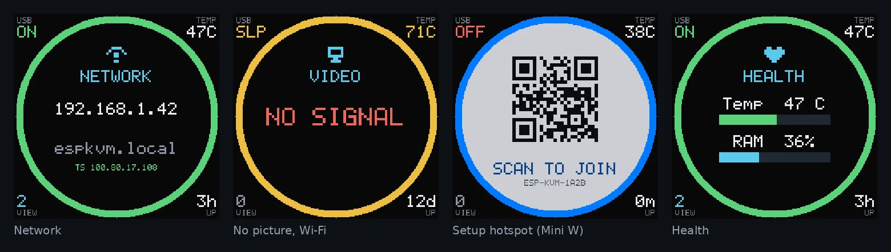
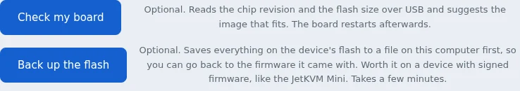
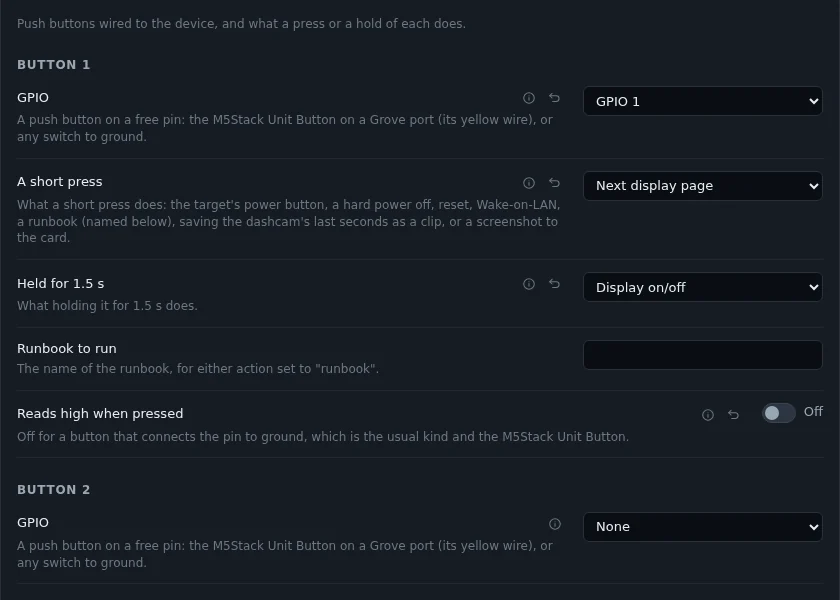

The JetKVM Mini is a small finished KVM, 42 x 42 x 23 mm. Inside is the ESP32-P4X, the chip ESP-KVM runs on. JetKVM published its firmware in November, and from the pins in it I made ESP-KVM images for the Mini and the Mini W. Thank you, JetKVM, for building such a nice small box and for opening its firmware.

## A first version

This is the first ESP-KVM version for the Mini, and it has not been through enough testing yet. It cannot harm the device: at worst the image does not start, and you flash it again over USB. Still, for now flashing it is at your own risk. Back up the flash first, as described below: the backup is the only way back to JetKVM's firmware. Once the testing is done, I will say so on the [Mini's page](/boards/jetkvm-mini/), and from then on it can be installed without any worry.

## What the images use

- The HDMI input, through the TC358743.
- Ethernet on the Mini, the ESP32-C5 for Wi-Fi on the [Mini W](/boards/jetkvm-mini-w/). The C5 keeps the firmware it ships with.
- The microSD slot.
- The 240x240 screen, on from the first boot.
- Both buttons on the side. SW2 resets the password. SW3 shows the next page on the screen, and holding it turns the screen off or on.

The Mini has no pins to wire anything to, so the settings for ATX, the UART serial console, a clock module and HDMI audio fold to one line there. The serial port over the target's USB cable still works.

## The screen

The screen is square, and the round layout from the GC9A01 sits in the middle of it. The corners show the USB link to the target, the chip temperature, how many browsers are watching and the uptime.

The same panel type, ST7789 240x240, also works as a separate module on any board.

## Before you flash

JetKVM's firmware takes only updates signed by JetKVM, so ESP-KVM goes on over USB:

1. Check the eFuses with `espefuse.py summary`. With Secure Boot or flash encryption on, the device will not run anything unsigned.
2. Turn on "USB debugging" in JetKVM's settings, so the USB port stays open for the flasher.
3. Back up the whole flash. The [flasher](/flash/) has a new button for it, Back up the flash, which saves the 16 MB to a file. It works on any ESP32-P4 board.
4. Flash ESP-KVM from the flasher.

## For every board

Buttons have their own section in Settings now, with up to four buttons. Each has its own pin, a short-press action and a hold action. Two new actions drive the status display: next page, and display on/off. A button set up before keeps its pin and its actions.

The status display has two new settings. Brightness works on a colour SPI panel with its backlight pin set. "Each page for" sets how many seconds a page stays up. At 0 a page stays until a button turns it.

## Fixed

- The console counted a hidden pin setting as taken when its condition was "not equal to", so a free pin could look busy.

[Release 0.80.0 on GitHub](https://github.com/espkvm/espkvm/releases/tag/v.0.80.0)
