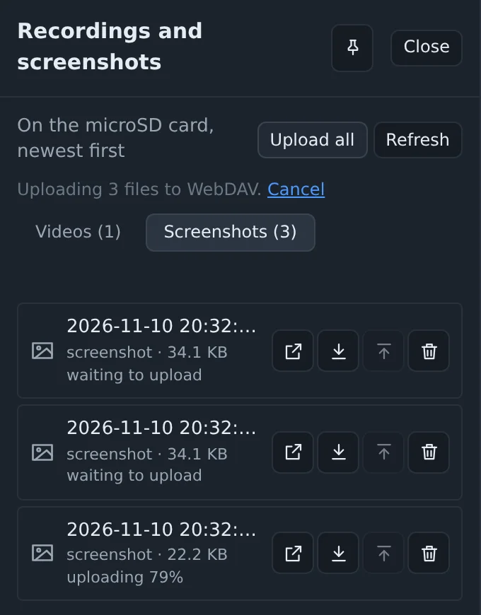
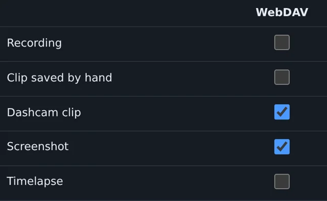

Recordings, clips and screenshots stay on the device's microSD card, and to get one off it you had to download it through the console. Now the device sends them to a folder of yours.

## Where they go

Any WebDAV server: Nextcloud, ownCloud, the WebDAV share on a Synology or QNAP, Apache or nginx with the module on. Set the folder, a user name and a password in Settings, Video, Upload, and press Check the folder. The device makes a folder named after itself there, with VIDEO and SCREENSHOTS inside, so several devices can share one folder.

On Nextcloud the address looks like `https://cloud.example.com/remote.php/dav/files/you/espkvm/`, and the password should be an app password, made under Settings, Security.

## By hand

Each file in the recordings panel has an Upload button, and Upload all sends the whole tab, oldest first. Files go one at a time, and under each one the panel shows how far it got. Cancel stops the file that is going and the ones still waiting. A recording takes its subtitles along.

The device reads a file from the card in small pieces as it sends it, so a 4 GB recording needs no more memory than a screenshot. On my bench, over plain http on the local network, a 21 MB recording took 3.4 seconds.

## Without a click

The second table in the same section picks what goes by itself: recordings, clips saved by hand, dashcam clips, screenshots and timelapses. A ticked kind goes as soon as it is saved on the card.

The case I wanted this for is the dashcam. The machine in the closet shows a stop screen at night, the dashcam saves the minutes before it, and by the morning the clip is on the NAS. If the device dies after that, the clip is already off it.

If the server does not answer, the whole queue waits. The first retry comes after half a minute, then the gaps double up to ten minutes. The files that still wait are listed on the card, so a restart or a power cut does not lose them. While someone watches the picture, an upload slows down to about 1 MB/s and leaves the card and the network to the live video.

## Notifications: what goes where

Settings, Notifications has a table now, a row per event and a column per channel: Telegram, a webhook and the browsers that signed up for notifications. A phone can get only the Tailscale key reminder, say, while Telegram gets everything. The old switches for a watched phrase, a blank screen and dashcam clips are carried over into the table. How to make a Telegram bot for it is on the new [Telegram page](/integrations/telegram/).

## Also in this release

- In full screen with the keyboard lock on, Esc goes to the target, so vi and other programs that need it work. Holding Esc leaves full screen. Chrome and Edge only.
- H.264 could drop to MJPEG until a restart on a device that had run for a long time. The encoder rebuild checked the wrong kind of free memory. It now checks the right one, and keeps the old encoder when there is no room.
- When frames stop arriving, the log now says whether anything comes down the ribbon from the capture board at all.

[0.81.0 on GitHub](https://github.com/espkvm/espkvm/releases/tag/v.0.81.0)
