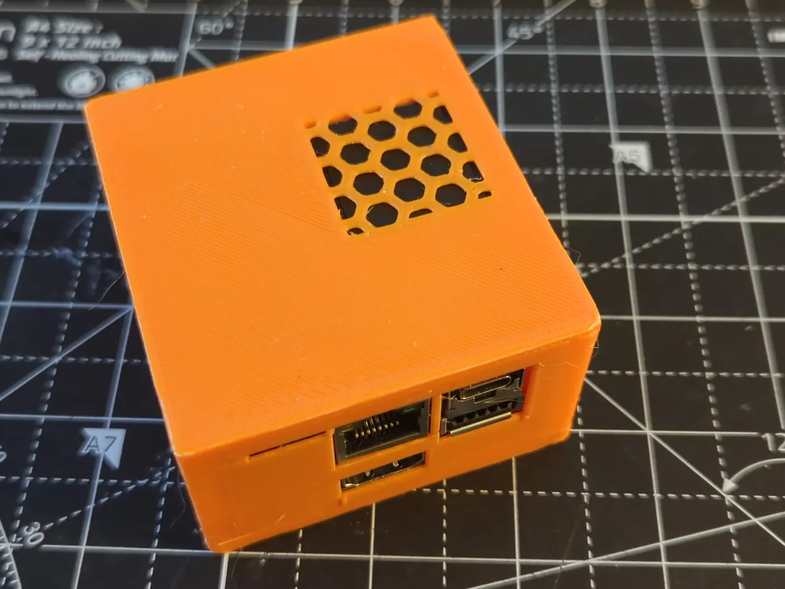
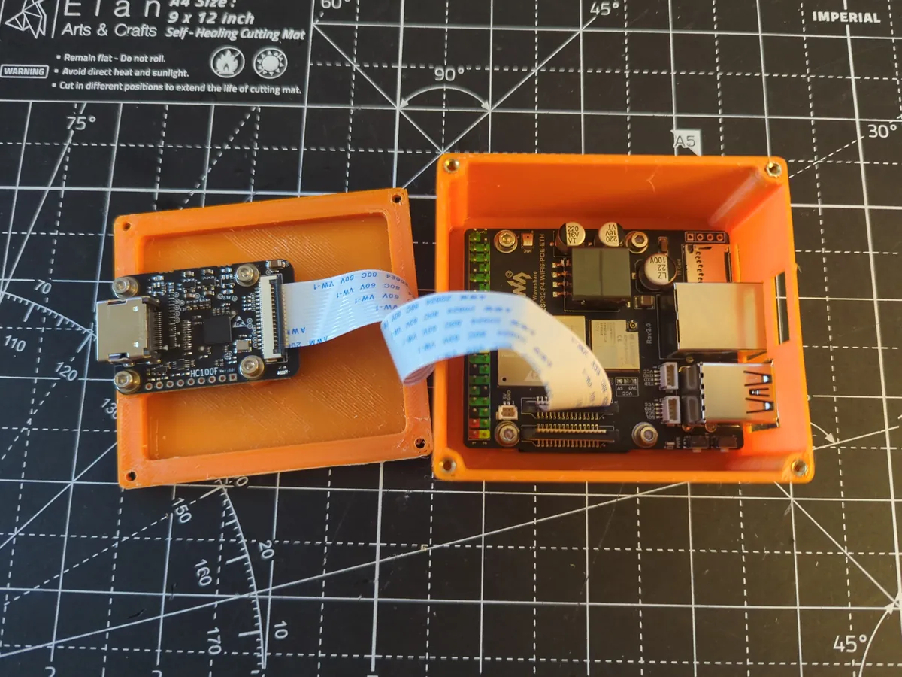

Steve Shockley shared [a case](https://www.printables.com/model/1867223-esp32-p4-wifi6-poe-eth-kvm-case) for the Waveshare ESP32-P4-WIFI6-POE-ETH and Waveshare's HDMI to CSI board. Before it there were [jrowny's box](/cases/p4poe-jrowny/) and [dangamboa's remix](/cases/p4poe-dangamboa/).

There are two printed parts. The P4 board goes in the tray, and the HDMI board sits on the inside of the lid. The ribbon cable stays connected, and the lid folds over onto the tray. The tray has a honeycomb vent, and the latest version adds holes and channels for the Boot and Power buttons. The photos show an earlier version without them.

Besides the two STL files, Steve published the parametric FreeCAD model. To fit a different cable or move a hole, change a dimension and export again. The files are free for non-commercial use under Creative Commons.

The case is listed on [the board's page](/boards/p4-poe/) with the other two. The photos are by Steve.

[The case on Printables](https://www.printables.com/model/1867223-esp32-p4-wifi6-poe-eth-kvm-case) · [the files on Codeberg](https://codeberg.org/sshockley/ESP32-P4-Wifi6-POE-Eth) · [the discussion](https://github.com/orgs/espkvm/discussions/92)
