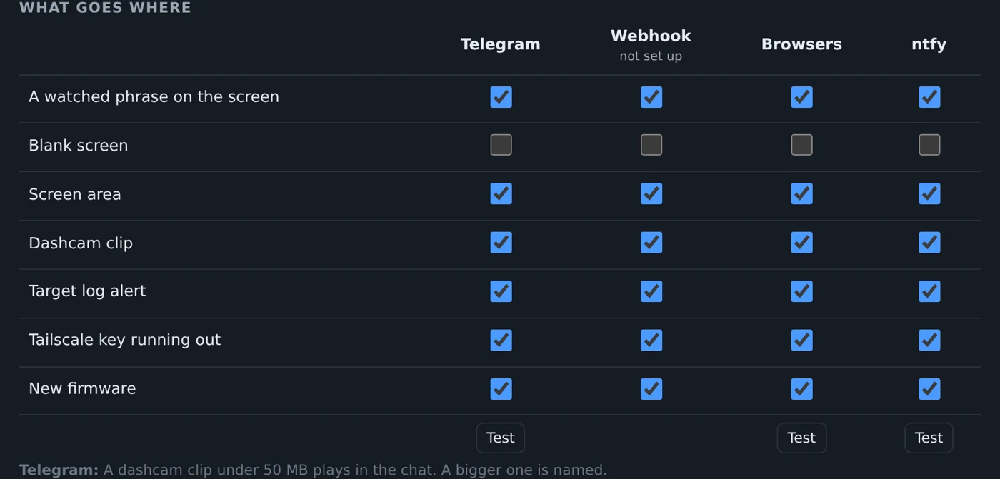
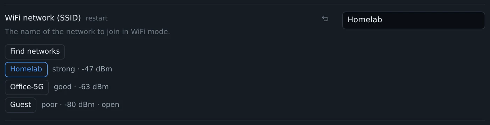

Alerts went to Telegram, a webhook or the browser. ntfy is the fourth channel now, and it takes the screenshot too.

## ntfy

[ntfy](https://ntfy.sh/) is a small push service: post to a topic, and every phone subscribed to it gets the message. No bot to make, no account on ntfy.sh, and you can run the server yourself. It is a new column in the table under Settings, Notifications, next to Telegram, the webhook and the browsers.

Put the topic's address in, say `https://ntfy.sh/espkvm-7f3k9q2m`. A topic on ntfy.sh is readable by anyone who knows its name, so make the name long. For a topic behind a login there is a field for an access token or a user and password. The screenshot goes along as an attachment. A server that takes no attachments gets the text alone.

Each channel that is set up now has its own Test button under the table, so trying ntfy does not also post to Telegram. Setup steps are on the [ntfy page](/integrations/ntfy/).

## A message when a new release is out

The table got a New firmware row. With Offer firmware updates on, the device reads the update manifest once a day and sends one message per release, with a link to what changed. The row is ticked for every channel to start with. Untick it everywhere and the device does not look at all: this is the only thing it asks the internet on its own.

## Three Wi-Fi networks

Settings, Network takes up to three networks now. With more than one, the device scans before it joins and picks the strongest one it knows. When it sees none of them, it tries them in turn.

Under each name there is a Find networks button. It lists what the device can see, strongest first, and a click fills the name in. The scan needs Wi-Fi on, so the network mode has to be wifi or auto.

## Fixed

- A WebSocket stayed open after the sign-in it was opened under had ended: a logout, an expiry, a changed password. A view-only sign-in's socket was then treated as the owner's, so it could type and click. Sockets now need a live sign-in, and a logout or a password change closes them.
- After four wrong passwords the device slept up to 15 s before every answer, and the whole web server waited with it, the owner's own sign-in too. It now answers 429 at once until the pause is over. Wrong current passwords and wrong two-factor codes count as well.
- A button set to change the network mode, the hotspot or the display crashed the device.
- A time zone longer than 39 characters made every schedule fire three times in its minute. A schedule that restarts the device ran again after its own restart.
- The pin probe could take the SD card or Ethernet offline until a restart. It now leaves the board's own pins alone.
- On a Mac, a key pressed together with Cmd stayed down on the target.

The rest is in the [changelog](https://github.com/espkvm/espkvm/blob/main/CHANGELOG.md).

[0.82.0 on GitHub](https://github.com/espkvm/espkvm/releases/tag/v.0.82.0)
