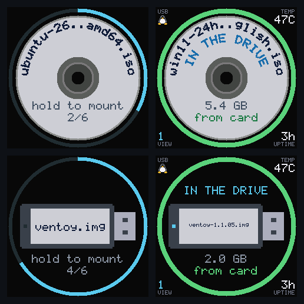

Some admins carry a USB drive with a small screen and a few buttons, like an [IODD](https://iodd.kr/) or a [Zalman VE](https://rmprepusb.com/tutorials/034-the-zalman-zm-ve200-sata-hard-disk-caddy-with-dvd-hdd-fdd-emulation/). It holds a folder of ISOs, and they pick one on the drive before they boot a machine from it. ESP-KVM can now do the same from its own status screen, with no console open. The JetKVM Mini has the screen and the buttons built in.

## The menu

With virtual media on (Settings, Storage), the menu on the status screen has a Virtual media item. It goes through the images on the microSD card, the rescue image if one is written, Eject and Back. A press shows the next one, a hold mounts it. On a text screen the image in the drive has a `*` in front, and a long name shows its start on the first line and its end on the second.

The menu sets the same setting as the console's Media panel. So the console, the API and MQTT see the choice at once, and it stays after a restart.

On the Mini the bottom side button opens the menu. On other boards it is any button set to "menu on the screen", see [docs/wiring.md](https://github.com/espkvm/espkvm/blob/main/docs/wiring.md).

## The Media page

While the drive holds an image, the status screen has one more page: the file name, CD-ROM or disk, the size and where the image is read from. That is the card, a URL, the console tab or the rescue slot. [0.87.0](/blog/0-87-0-boot-without-the-card/) added the URL and the tab. After Eject the page goes away.

## Discs and sticks

On a colour screen, like the Mini's, each image looks like what the target will get. An ISO is a disc with the file name written round its label, the way you would write on a CD-R. Any other image is a USB stick. When a disc goes in it spins up and stops, and a stick blinks its light. The screen turns to the Media page whenever an image is mounted, from the menu, the console or the API.

