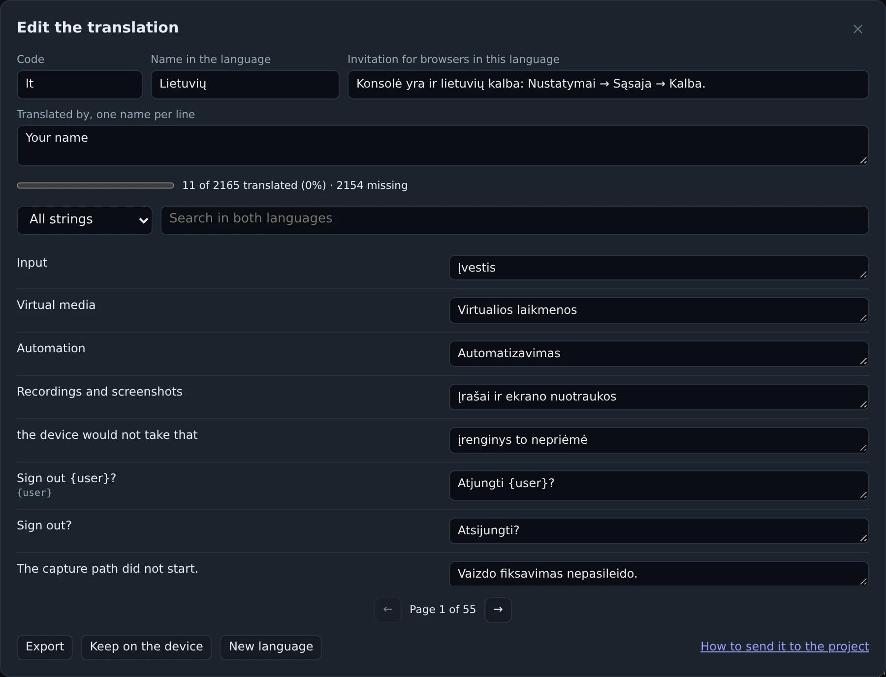

A KVM does not type letters. It presses keys, and the target's own layout decides what each key gives. So when text is pasted, ESP-KVM has to know where every character sits on the target's keyboard. Until now it knew five layouts. A German who pasted `yes` got `zes`.

## Sixteen more layouts

German, French, Spanish, English (UK), Italian, English (US, international), Portuguese, Portuguese (Brazil), Spanish (Latin America), Swedish and Finnish, Norwegian, Danish, Polish, Belgian, Swiss German and Swiss French. With the five from before that is 21.

Accented letters go in the way a person types them, with a dead key first. On a German target `é` is `´` and then `e`.

Windows and Linux do not always agree on a layout. On French, `~` is a dead key on Windows and a plain key on Linux. So each of these layouts comes in two versions, and the Target OS setting picks one. With the OS unknown, in a BIOS say, only what both agree on is typed, and the console names the characters it skipped.

A script builds the tables from Unicode CLDR for Windows and from the X keyboard database for Linux, and CI checks them against both on every push.

## Picked next to the paste box

The layout is now right there in the Input panel, next to Paste text, so switching it for one machine is a click. If your own keyboard has a different layout, the console notices it from your typing and offers it once. It never switches by itself: the target's layout is what counts, and a desk with a Russian keyboard often drives a server with a US one.

## A console in your language

The console can now be translated. Settings, UI, Language downloads a language into the browser, so each person can pick their own. A translation is a JSON file with the English text as the key, so a sentence I change later just shows in English until its translation catches up, so an out-of-date translation never shows.

The device can also keep one language of its own. Every browser that has not picked one then opens in it, the sign-in page too, and it works with no internet. Text the device sends, like the titles and help of the settings, goes through the same file.

A language file is checked every time the console loads it. One that is not a language file at all is refused. A bad line, such as one with a placeholder the English does not have, is left out and shows in English.

Right now the console has no translation into any language. That is where I need help.

## Translate it into your language

If you would like the console in your language, you can translate it yourself, with no device and no code. Everyone who uses ESP-KVM in that language will be grateful. Before you start, [open an issue](https://github.com/espkvm/espkvm/issues) saying which language you are working on, so two people do not translate the same one. Check the open issues first: someone may already be on it.

Settings, UI, Language, Edit... opens an editor: every English string next to a field for its translation, how much is done, and what still has a problem. A change shows on the console at once, and Export saves the file.

The editor is in the [demo](https://demo.espkvm.io/) too. The [translations page](/translations/) lists the languages with how much of each is done, and shows each one next to the English. [TRANSLATING.md](https://github.com/espkvm/espkvm/blob/main/docs/TRANSLATING.md) says how to send the file when it is done. A partial one is fine. Your name goes in the file too, and the console shows it under the language: "Translated by ...".

The release: [v.0.90.0](https://github.com/espkvm/espkvm/releases/tag/v.0.90.0).
